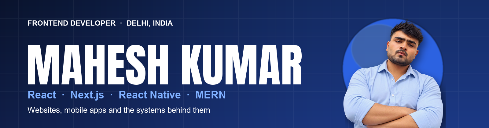
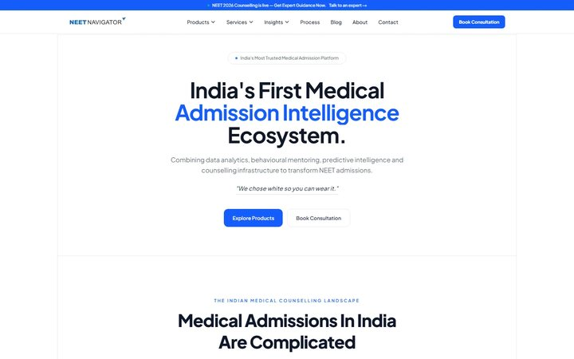
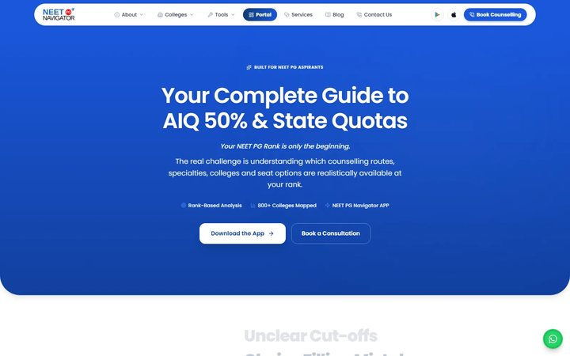
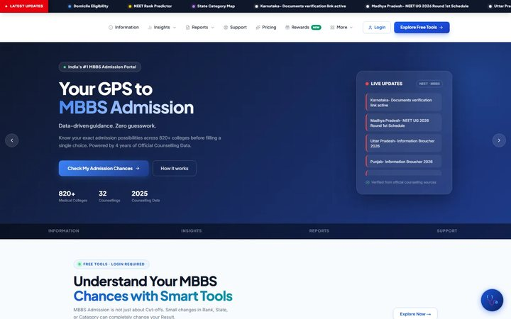
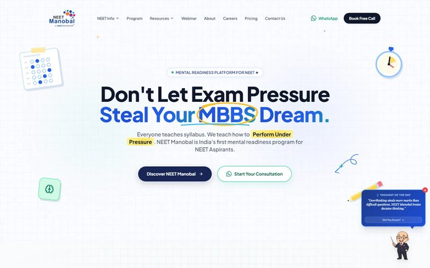
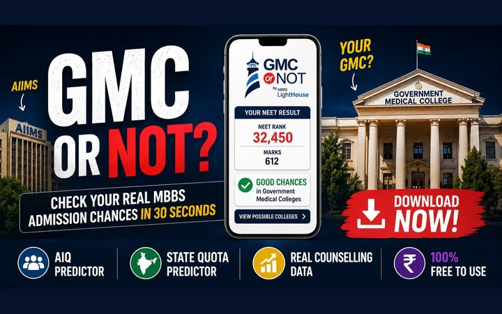
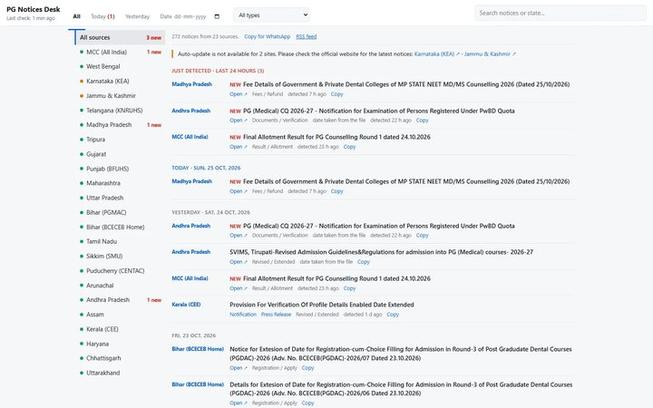

  

  Frontend developer from Delhi, India. I build fast <b>React</b> and <b>Next.js</b> websites, <b>React Native</b> apps and the systems behind them: APIs, payments, admin tools and deployment.

  
  
  
  
  

---

## About

- Developer on the **NEET Navigator** ecosystem: public websites, student dashboards, admin and CRM tools, two mobile apps and one shared backend.
- Earlier: Frontend Developer at **Nickicon Information Technology** (live coding platform, WebRTC and Socket.IO streaming and chat). MERN full-stack training at **Ducat India**. BCA, **IGNOU**.
- I care about three things: interfaces that match the design on every device, pages that load fast and rank well, and features that actually reach production.
- Open to freelance projects and full-time roles. Based in Delhi NCR, working remotely across India.

## Selected work

All live. Click a project to open it.

<table>
  <tr>
    <td width="50%" valign="top">
       
      <b><a href="https://neetnavigator.com">NEET Navigator</a></b> 
      Flagship website and product hub for NEET UG, PG and NRI admissions. Next.js 16, WebGL and GSAP motion, student dashboard with wallet.
    </td>
    <td width="50%" valign="top">
       
      <b><a href="https://neetpgnavigator.com">NEET PG Navigator</a></b> 
      Counselling portal: college directory, cut-offs, fee structure, choice-list builder, reports and a credits wallet with Razorpay.
    </td>
  </tr>
  <tr>
    <td width="50%" valign="top">
       
      <b><a href="https://mbbslighthouse.in">MBBS Lighthouse</a></b> 
      MBBS admission intelligence: college database, seat matrix, round-wise cut-offs and rank predictors. 100+ routes, Redux Toolkit.
    </td>
    <td width="50%" valign="top">
       
      <b><a href="https://neetmanobal.com">NEET Manobal</a></b> 
      Mentoring program site for NEET UG aspirants: webinars, mock tests, guides and a call-booking journey, with SEO schema.
    </td>
  </tr>
  <tr>
    <td width="50%" valign="top">
       
      <b><a href="https://neetnavigator.com/products/gmc-or-not">GMC or NOT</a></b> (iOS and Android) 
      Enter a NEET rank and see the chances in government medical colleges. React Native, Expo Router, Google and Apple sign-in.
    </td>
    <td width="50%" valign="top">
       
      <b><a href="https://mahesh-kumar99.github.io/PG_notifications/">PG Notices Desk</a></b> 
      Live feed of NEET PG counselling notices from MCC and 22 states, scraped every 10 minutes. Python, GitHub Actions and Pages.
    </td>
  </tr>
</table>

### What sits behind those sites

| | |
|---|---|
| **11** web apps | public sites, CRM, admin, mentor, support and report panels |
| **330+** pages and routes | Next.js App Router |
| **550+** API routes | one Node.js and Express backend, 100+ database tables |
| **2** mobile apps | React Native with Expo (iOS and Android) |

Numbers are counted from the code base. The stack includes Razorpay payments with webhook verification, role-based and multi-tenant access, AWS S3, WhatsApp campaigns in the CRM, Docker and Azure Pipelines.

## Open source

| Repository | What it does |
|---|---|
| [**PG_notifications**](https://github.com/MAHESH-KUMAR99/PG_notifications) | A live desk of NEET PG counselling notices. A Python monitor reads 23 official sources, diffs them against what it has seen, and GitHub Actions publishes the page and an RSS feed every 10 minutes. |
| [**notification-**](https://github.com/MAHESH-KUMAR99/notification-) | A Next.js board that mirrors MCC, NTA, NMC and state counselling notices verbatim. Watchers configured in JSON scrape on a schedule and commit new notices back to the repo, so there is no database. |

## Tech stack

**Frontend** &nbsp;

**Mobile** &nbsp;

**Backend and data** &nbsp;

**Tooling and delivery** &nbsp;

## Get in touch

If you have a website, an app or an admin tool to build, or a role to fill, message me on [WhatsApp](https://wa.me/919315105191), email [MK766263@gmail.com](mailto:MK766263@gmail.com), connect on [LinkedIn](https://www.linkedin.com/in/mahesh-kumar-dev), or [download my resume](./Mahesh-Kumar-Resume.pdf). More of my work is at [mahesh-dev-zeta.vercel.app](https://mahesh-dev-zeta.vercel.app).
